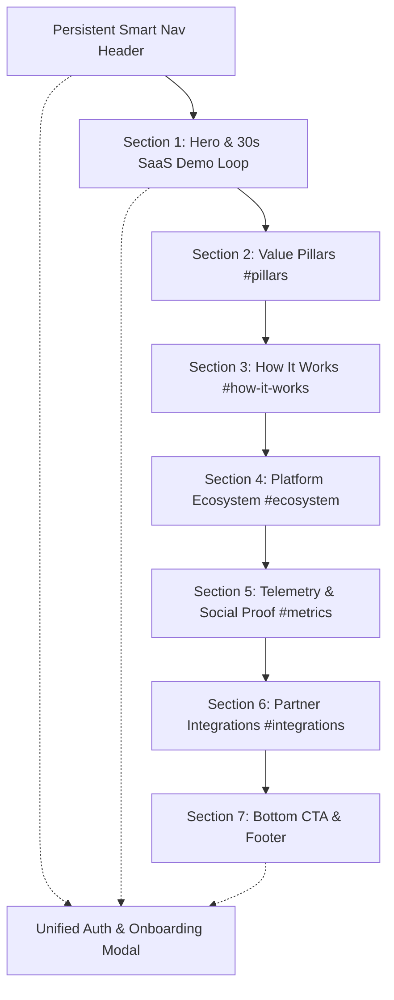

# Matager SaaS — Design System & UI Identity Specification

> **Document Version:** 2.0  
> **Target Framework:** Next.js 14+ (App Router) / Tailwind CSS / Vanilla CSS Variables  
> **Brand Vision:** *"One Platform, Infinite Possibilities — Unified Commerce Operating System"*

---

## 1. Brand & Logo Identity

### 1.1 Logo Asset & Iconography
* **App Icon Asset:** `/public/app-icon.png` (Isometric 3D cube rendered in primary gradient `#0479E8` &rarr; `#0083FE` with an upward-pointing arrow tip, symbolizing growth and commerce synchronization).
* **Wordmark Typography:**
  * **English (`en`):** `Josefin Sans` (SemiBold / Medium), tight tracking (`-0.03em`), clean geometric baseline.
  * **Arabic (`ar`):** `Reem Kufi` (Medium), natural cursive spacing (`0px` tracking).
* **Wordmark Sizing Scale:**
  | Size | Icon Box | Text Class (EN) | Text Class (AR) | Application |
  | :--- | :--- | :--- | :--- | :--- |
  | `sm` | `28px` | `text-[17px] tracking-tight` | `text-[18px]` | Modals, table headers, breadcrumbs |
  | `md` | `36px` | `text-[20px] tracking-tight` | `text-[22px]` | Main header navigation, standard cards |
  | `lg` | `48px` | `text-[26px] tracking-tight` | `text-[28px]` | Footer banner, onboarding header |
  | `xl` | `68px` | `text-[38px] md:text-[44px]` | `text-[42px]` | Splash / Hero convergence state |

### 1.2 Component Reference
* File: `src/components/brand/MatagerLogo.tsx`
* Supports dynamic locale auto-detection (`Matager` &harr; `متاجر`), optional entrance animation via Framer Motion, and accessible label bindings.

---

## 2. Typography Rules & Strict Font System

> **Rule:** In English mode, fonts must be strictly between **Josefin Sans** and **Poiret One**. In Arabic mode, fonts must be strictly between **Reem Kufi** and **Fustat**.

### 2.1 Mode-Specific Font Allocation

#### English Mode (`lang="en"`, `dir="ltr"`)
* **Headings & Display (`--font-heading`):** `Josefin Sans` (`--font-josefin`), sans-serif.
  * Usage: Hero display titles, section headings, card titles, large metrics.
* **Subtitles & Badges (`--font-subtitle`):** `Poiret One` (`--font-poiret`), sans-serif.
  * Usage: Subheaders, category tags, step indicators, decorative quotes.
* **Interface & Form Controls (`--font-ui`):** `Josefin Sans`, `Poiret One`, sans-serif.
  * Usage: Buttons, form labels, inputs, navigation links, data tables.

#### Arabic Mode (`lang="ar"`, `dir="rtl"`)
* **Headings & Display (`--font-heading`):** `Reem Kufi` (`--font-reem-kufi`), `Fustat`, sans-serif.
  * Usage: Main Arabic titles, hero tagline, major section headers.
* **Subtitles & Badges (`--font-subtitle`):** `Fustat`, `Reem Kufi`, sans-serif.
  * Usage: Arabic subtitles, supporting paragraphs, explanatory labels.
* **Interface & Form Controls (`--font-ui`):** `Fustat`, `Reem Kufi`, sans-serif.
  * Usage: Arabic inputs, buttons, navigation items, onboarding step forms.

### 2.2 Typographic Metrics Scale
```css
--text-caption:    12px;  /* Line-height: 1.5   | Tracking: -0.03em (EN) / 0px (AR) */
--text-body-sm:    14px;  /* Line-height: 1.43  | Tracking: -0.03em (EN) / 0px (AR) */
--text-body:       16px;  /* Line-height: 1.5   | Tracking: -0.03em (EN) / 0px (AR) */
--text-body-lg:    18px;  /* Line-height: 1.56  | Tracking: -0.03em (EN) / 0px (AR) */
--text-subheading: 24px;  /* Line-height: 1.25  | Tracking: -0.025em (EN) / 0px (AR) */
--text-heading-sm: 30px;  /* Line-height: 1.2   | Tracking: -0.03em (EN) / 0px (AR) */
--text-heading:    34px;  /* Line-height: 1.2   | Tracking: -0.03em (EN) / 0px (AR) */
--text-display:    48px;  /* Line-height: 1.0   | Tracking: 0px (EN) / 0px (AR) */
```

* **Arabic Cursive Rule:** Letter spacing (`letter-spacing`) is unconditionally locked to `0px` for all Arabic glyphs to preserve natural ligatures and letter connectivity.

---

## 3. Color Palette & Atmospheric Gradients

### 3.1 Primary Brand Gradient
* **CSS Value:** `linear-gradient(135deg, #0479E8 0%, #0083FE 100%)`
* **Stop 1 (Dark Blue):** `#0479E8` (`--color-primary-dark`)
* **Stop 2 (Lighter Blue):** `#0083FE` (`--color-primary-light`)
* **Role:** Primary accent, glowing badges, active step highlights, selected card borders, interactive icons.

### 3.2 Dark Theme Tokens (Obsidian Command Surface — Default)
| Token Name | Hex / Value | Description |
| :--- | :--- | :--- |
| `--color-canvas` | `#000000` | Deepest Void Black canvas background |
| `--color-surface` | `#050607` | Carbon card surface for content containers |
| `--color-surface-elevated` | `#090a0d` | Elevated cards, dropdowns, and floating menus |
| `--color-surface-hover` | `#0f1115` | Interactive hover state for cards and list items |
| `--color-text-primary` | `#ffffff` | Pure Ghost White for primary headings and values |
| `--color-text-secondary` | `#b3b3b3` | Ash Gray for body copy and supporting text |
| `--color-text-muted` | `#808080` | Steel Gray for metadata, timestamps, and captions |
| `--color-border` | `#333333` | Crisp structural borders |
| `--color-border-subtle` | `rgba(255, 255, 255, 0.07)` | High-precision translucent card dividers |
| `--color-accent-mint` | `#3fcb7f` | Mint Signal for online status, POS pulse, live sync |
| `--input-bg-gradient` | `linear-gradient(135deg, #1a1a24 0%, #2a3a50 100%)` | Two-color modern gradient for form fields |
| `--input-border-color` | `rgba(4, 121, 232, 0.35)` | Accent border for form inputs |

### 3.3 Light Theme Tokens
| Token Name | Hex / Value | Description |
| :--- | :--- | :--- |
| `--color-canvas` | `#fcfcfd` | Ultra-clean soft paper canvas |
| `--color-surface` | `#ffffff` | Pure white cards |
| `--color-surface-elevated` | `#f4f5f7` | Elevated containers and panels |
| `--color-surface-hover` | `#ebedf0` | Hover states |
| `--color-text-primary` | `#0a0b0d` | Obsidian dark text |
| `--color-text-secondary` | `#4b5260` | Slate body copy |
| `--color-text-muted` | `#6b7280` | Muted cool gray |
| `--color-border` | `#e3e6eb` | Crisp borders |
| `--input-bg-gradient` | `linear-gradient(135deg, #f0f6ff 0%, #e2eeff 100%)` | Light blue tinted input gradient |
| `--input-border-color` | `rgba(4, 121, 232, 0.25)` | Light accent input border |

### 3.4 Button System
1. **Primary Black Action Buttons (`.msm-next`, `.btn-primary-pill`):**
   * Solid dark background (`#000000` or `#0a0b0d`), high-contrast white text, subtle hover lift. Kept intact as the signature high-priority action button.
2. **Ghost & Outline Action Buttons (`.btn-ghost-action`):**
   * Translucent surface, fine border (`--color-btn-outline-border`), subtle glow on hover.

---

## 4. Navigation Architecture & Smart Dynamic Navbar

* **Component:** `src/components/landing/LandingHeader.tsx`
* **Features:**
  1. **Smart Scroll Hide:** Disappears smoothly when scrolling down (`scrollY > 120px` & descending) to provide distraction-free reading.
  2. **Increased Height Reveal on Hover / Toggle:**
     * Expands to lavish height (`py-4 sm:py-5 px-5 sm:px-6`) with an amplified backdrop blur (`backdrop-blur-xl`), refined glow ring (`ring-1 ring-[#0479E8]/30`), and expanded action drawer.
     * Accessible manual expand button (`Compass` / `ChevronDown`) for keyboard and mobile users.
  3. **Auto-Scroll with Offset:**
     * Direct smooth navigation to sections: `#pillars`, `#how-it-works`, `#ecosystem`, `#metrics`, `#integrations`.
     * Applies precise top offset (`-90px`) to prevent content from being obscured by the floating header.

---

## 5. Page Structure & Section Catalog

The Matager application consists of **1 Primary Hub Landing Page (`/`)** composed of **7 High-Conversion Content Sections + Persistent Header + Terminal Footer + 1 Unified Onboarding & Authentication Modal**.



---

### Section 1: Hero & 30-Second Looping SaaS Demo
* **File:** `src/components/landing/HeroTerminalMockup.tsx` & `src/app/page.tsx`
* **Anchor:** `#top`
* **Purpose:** First impression, value proposition statement, and live interactive proof of unified store & POS functionality.
* **Key Elements:**
  * Status Pill Badge with Mint Live Pulse dot (`Matager 2.0 Live`).
  * Display Heading: *"Matager — Unified Commerce Operating System"*.
  * Supporting Subhead: *"Unify your physical stores and digital storefronts in a single real-time inventory engine."*
  * Call to Action Row: Primary Black Pill button (`Launch Free Store`) + Ghost Action button (`Sign In`).
  * Trust Line with `ShieldCheck` icon: *"Zero Fraud Risk · Real-Time Multi-POS Sync · Escrow Protected"*.
  * **30-Second 8-Scene Interactive Looping Demo:**
    1. *Scene 1 (0–3s):* **Store Creation** (Split-screen mobile admin & desktop storefront materializing live).
    2. *Scene 2 (3–6s):* **Product Management** (Form auto-populates, 3 glowing toggle switches: Website, POS Cashier, Both Channels).
    3. *Scene 3 (6–10s):* **Multi-POS Synchronization** (5 terminals linked to Central Inventory; real-time sale at POS 1 drops inventory from 48 &rarr; 47 with green pulse waves across all 5 screens).
    4. *Scene 4 (10–14s):* **Admin Dashboard Control** (Real-time analytics graphs, live revenue ticker `$12,847 ↑`, 23 active orders).
    5. *Scene 5 (14–18s):* **Protected Payments & Escrow** (Customer checkout with Mada, Apple Pay, Visa; Matager Escrow badge; customer gets confirmation while merchant receives payout release notification).
    6. *Scene 6 (18–22s):* **Shipping & Fulfillment** (Carrier selector for DHL, FedEx, Aramex, SMSA; animated doorstep parcel route).
    7. *Scene 7 (22–25s):* **Bilingual Instant Morph** (Live flip between English and Arabic, RTL inversion, currency conversion).
    8. *Scene 8 (25–30s):* **Unified Ecosystem Finale** (All floating modules converge into the Matager Cube Logo; taglines: *"Matager — Complete Commerce Ecosystem"*, *"Create. Sell. Manage. All in One."*).
  * Interactive playback bar with scene jumping chips, play/pause toggle, and timeline progress bar.

---

### Section 2: Core Value Pillars
* **File:** `src/components/landing/ValuePillars.tsx`
* **Anchor:** `#pillars`
* **Purpose:** Detail the 4 foundational pillars that give merchants unfair operational advantage.
* **Content Cards:**
  1. **Unified Real-time Inventory:** Bi-directional sync across all physical registers and online stores in under 120ms.
  2. **High-Speed POS Checkout:** Offline-first architecture capable of processing peak retail volume without lag.
  3. **Zero Fraud Escrow Payments:** Direct settlement pipeline protecting both merchant balance and buyer checkout.
  4. **Multi-carrier Automated Dispatch:** Pre-integrated shipping with instant waybill creation and doorstep tracking.

---

### Section 3: How It Works (3-Step Connected Flow)
* **File:** `src/components/landing/HowItWorks.tsx`
* **Anchor:** `#how-it-works`
* **Purpose:** Demystify the onboarding journey and prove merchant time-to-value.
* **Connected Flow:**
  * **Step 01: Setup in 60 Seconds:** Choose your channel strategy, enter business credentials, and select your store domain.
  * **Step 02: Single-Entry Catalog:** Add a product once—it automatically deploys across web storefronts, mobile apps, and POS registers.
  * **Step 03: Central Command & Payouts:** Fulfill orders, print shipping labels, and receive escrow payouts automatically.

---

### Section 4: Modular Platform Ecosystem
* **File:** `src/components/landing/EcosystemGrid.tsx`
* **Anchor:** `#ecosystem`
* **Purpose:** Provide an architectural breakdown of the 4 core product modules that form the Matager suite.
* **Grid Layout:**
  * **Module A — Modern Web Storefront:** Headless Next.js storefront, lightning-fast SSR, mobile-responsive layout.
  * **Module B — Cloud & Offline POS Cashier:** Multi-register terminal support, barcode scanning, thermal receipt printing.
  * **Module C — Unified Merchant Console:** Stock matrix manager, staff access permissions, multi-branch analytics.
  * **Module D — Logistics & Fulfillment Gateway:** Native carrier integrations with discounted corporate rates.

---

### Section 5: Telemetry, Social Proof & Metrics
* **File:** `src/components/landing/SocialProofMetrics.tsx`
* **Anchor:** `#metrics`
* **Purpose:** Build enterprise credibility through live platform telemetry and merchant validation.
* **Telemetry Benchmarks:**
  * **$48,000,000+** Gross Merchandise Value processed.
  * **99.98%** Platform Uptime SLA guarantee.
  * **< 120ms** Inventory synchronization latency across terminals.
  * **14,000+** Active commercial cashiers & digital storefronts.
* **Merchant Testimonials:** Direct quotes from enterprise retail owners in Saudi Arabia and the Gulf region.

---

### Section 6: Native Partner Integrations Grid
* **File:** `src/components/landing/IntegrationsGrid.tsx`
* **Anchor:** `#integrations`
* **Purpose:** Showcase seamless interoperability with regional payment gateways, couriers, and ERPs.
* **Integrated Partners:**
  * **Payment Gateways:** Mada, Apple Pay, Visa, Mastercard, Tabby, Tamara.
  * **Logistics & Carriers:** DHL Express, FedEx, Aramex, SMSA Express.
  * **Accounting & Tax:** ZATCA E-Invoicing compliant, QuickBooks, Xero.

---

### Section 7: Final Conversion Call-to-Action & System Footer
* **File:** `src/components/landing/LandingFooter.tsx`
* **Purpose:** Final conversion hook before page termination, system copyright, and secondary utility navigation.
* **Key Elements:**
  * Elevated CTA Card: *"Ready to launch your unified retail enterprise?"*.
  * Launch Button triggering Merchant Sign-Up flow.
  * Operational status badge (`All Systems Operational`).
  * System copyright (`© 2026 Matager Technologies Ltd.`).
  * Instant Language Switcher (`EN` / `AR`) and Theme Switcher (`Dark` / `Light`).

---

### Modal Section: Unified Merchant Onboarding & Staff Sign-In Terminal
* **File:** `src/components/auth/AuthModal.tsx`
* **Trigger:** Click on any "Sign In" or "Launch Free Store" button across the entire interface.
* **Dual Roles:**
  1. **Store Owner Sign-Up (7-Step Wizard):**
     * *Step 1 — Sales Channels:* Choose between Hybrid Unified Store (Default), Online Storefront Only, or POS Cashier Only.
     * *Step 2 — Business Details:* Store name, registered legal entity name, store subdomain slug generator.
     * *Step 3 — Category Selection:* Retail, Fashion, F&B, Electronics, Health & Beauty, Services.
     * *Step 4 — Location & Tax:* Country picker (Saudi Arabia, UAE, etc.), City, physical store address.
     * *Step 5 — Security & Verification:* Owner email, mobile phone number, 6-digit OTP verification code.
     * *Step 6 — Plan Selection:* Starter (`plan-starter`), Growth (`plan-growth`), Enterprise (`plan-enterprise`) with live currency calculation.
     * *Step 7 — Review & Launch:* Comprehensive deployment summary and instant redirect to the live store management console.
  2. **Sign-In Portal:**
     * Toggle between **Store Owner** (Email + Password) and **Cashier / Staff Member** (Store ID + Terminal PIN).

---

## 6. Accessibility & Motion Guidelines

1. **Reduced Motion:** Fully honors `prefers-reduced-motion: reduce`. All GSAP scroll triggers and Framer Motion transitions collapse to instant states (`animation-duration: 0.001ms`).
2. **Screen Reader Live Regions:** Includes `src/components/common/LiveRegion.tsx` announcing modal opening/closing and language flips to assistive technology.
3. **Contrast Compliance:** All text tokens maintain minimum WCAG AAA contrast ratio (&ge; 7:1) against their container backgrounds.
